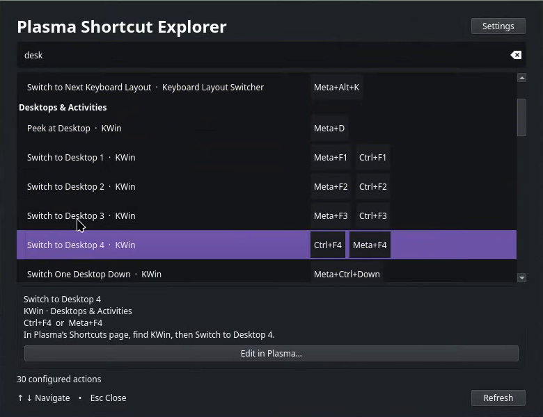
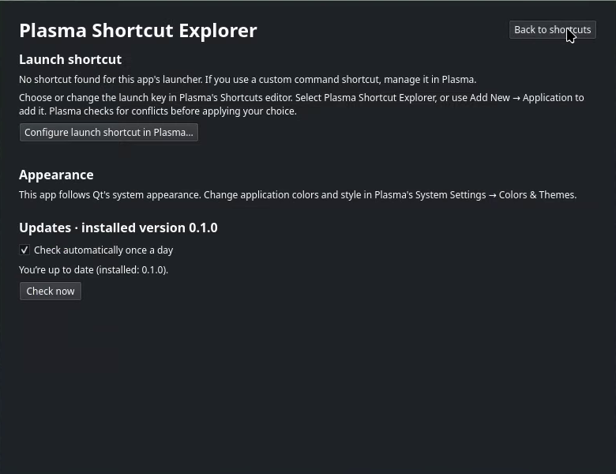

# Plasma Shortcut Explorer

Find the global shortcuts you have configured in KDE Plasma. Search by action,
application, category, or key combination, then open Plasma's settings to edit a
binding.



## Requirements

- KDE Plasma 6.0+ on Linux, with `KGlobalAccel` and a user D-Bus session
- Python 3.11+, PySide6 6.6 to 6.x (Qt Widgets and Qt Network), and `dbus-next` 0.2.3 to 0.2.x
- Qt 6 Wayland support for Wayland sessions
- Plasma System Settings to edit shortcuts

Tested on Plasma 6.8 under Wayland. Package targets: Arch Linux, Debian 13,
and Fedora 44.

## Install

Follow [INSTALL.md](INSTALL.md) to install a release package or build a per-user
installation from source. Arch users can use GitHub package downloads while AUR
publishing is pending.

Open **Plasma Shortcut Explorer** from the application menu or run
`plasma-shortcut-explorer`.

## Assign a shortcut

1. Open **System Settings → Keyboard → Shortcuts**.
2. Choose **Add New → Application** and select **Plasma Shortcut Explorer**.
3. Assign a shortcut you will remember. `Meta+K` is one suggestion if it is free.
4. Apply the change. If Plasma reports a conflict, choose another combination
   or reassign the existing binding yourself.

The shortcut opens the overlay with search focused. Type to filter, use the
arrow keys to select an action, and press Escape or switch focus to close it.
The app starts on demand and ignores repeated launches while it is open.

## Settings

Open **Settings**, press `Ctrl+,`, or run `plasma-shortcut-explorer --settings`.
The page shows the app's launch shortcut and opens Plasma's editor to change it.
Refresh or reopen the explorer after changing a binding.

Select a row to see its details. **Edit in Plasma…** opens that application's
shortcut settings. Find the named action there; selecting a row never runs it.



### Updates

The app checks GitHub for a newer stable release after the window opens. Checks
run asynchronously, at most once every 24 hours, with a ten-second timeout.
Settings has a **Check now** button and an option to disable automatic checks.

A newer version links to the release downloads. Install it using the same method
you used originally. Checks send the app version in the request's user agent,
but no shortcut data or credentials.

### Window placement

KWin controls window placement on Wayland. To center the overlay consistently,
[add a window rule](INSTALL.md#window-placement).

## Shortcut coverage

The explorer shows assigned global shortcuts from KWin, Plasma, registered
applications, and custom application launchers. It does not list application-local
menu shortcuts or bindings outside KGlobalAccel. It reads the daemon's selected
shortcut contexts and groups actions using category heuristics.

Changes appear when you refresh or reopen the app. Errors appear beneath the
list; hover over them for details. Use `--diagnose` to collect JSON diagnostics
when reporting a problem.

## Uninstall

For a per-user installation, run:

```sh
./scripts/uninstall.sh
```

This removes the app environment, launcher, and desktop assets. Use `--dry-run`
to preview removal or `--purge` to also remove update preferences. Remove your
launch shortcut and any window rule in Plasma System Settings.

For native packages, [uninstall with your package manager](INSTALL.md#uninstall-a-native-package).

[MIT licensed](LICENSE).

## Development

See [DEVELOPMENT.md](DEVELOPMENT.md) to set up the project, run tests, and inspect
shortcut discovery. [DESIGN.md](DESIGN.md) explains the architecture;
[RELEASES.md](RELEASES.md) covers builds and publication.
